# Independent Digital Product Project

**Product Lead / Project Creator** · AI-assisted product development · User experience · Iterative testing · Continuous improvement

I led the planning and iterative development of a multi-feature AI-powered web product, delivered as two installable web apps with a Chinese-language interface.

I owned product direction, interface structure, user flows, functional requirements, feature prioritisation, visual direction, testing and release acceptance. I used Claude as an AI coding assistant to translate those requirements into working front- and back-end functionality, then independently tested each release and defined the next iteration.

> I identified needs → defined the product structure → prioritised features → directed AI-assisted implementation → tested outputs → identified friction → refined requirements → released improvements.

A one-page PDF version of this case study: [case-study.pdf](./case-study.pdf).

---

## At a glance

| | |
|---|---|
| **12+ feature modules** | Chat, voice, notifications, a 3D desk scene, a bead-art studio, a board game, image gallery, diary, avatar manager and more |
| **Front end + back end** | AI-assisted implementation across an installable web app, serverless functions, notifications, voice, image features and encrypted cloud sync |
| **5,000+ automated checks** | 80+ test suites in the main app, run before releases, alongside my own hands-on testing on a phone |
| **6+ weeks of releases** | Small, frequent releases, each one requested, tested and accepted before the next |
| **2 apps, 9 visual themes** | Four themes in the main app, five in the second, each with its own colour system and artwork |

---

## My role

| | |
|---|---|
| **Product structure** | Defined the interface architecture, feature hierarchy and user flows |
| **Requirements** | Translated ideas and user needs into clear functional requirements |
| **Prioritisation** | Planned feature priorities and the order of releases |
| **Testing** | Tested functionality and usability on a real device, identified issues and validated fixes |
| **Iteration** | Turned observed friction into structured product changes |
| **AI workflow** | Directed AI-assisted implementation while reviewing outputs and product behaviour myself |

---

## Interface and experience design

I defined the overall product structure, navigation logic and visual direction. The same conversation is shown below in each theme.

**Main app: four themes**

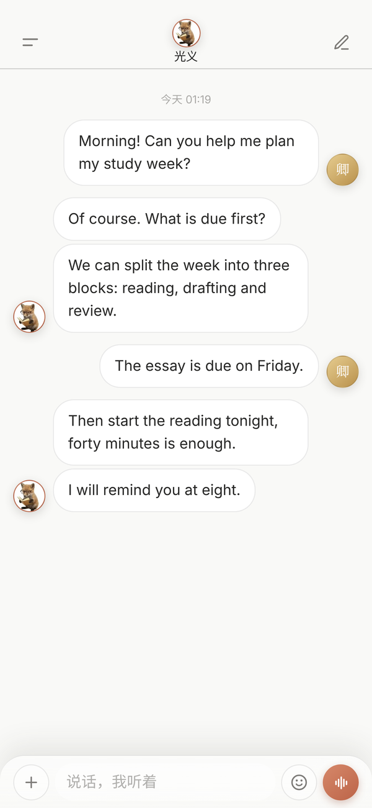
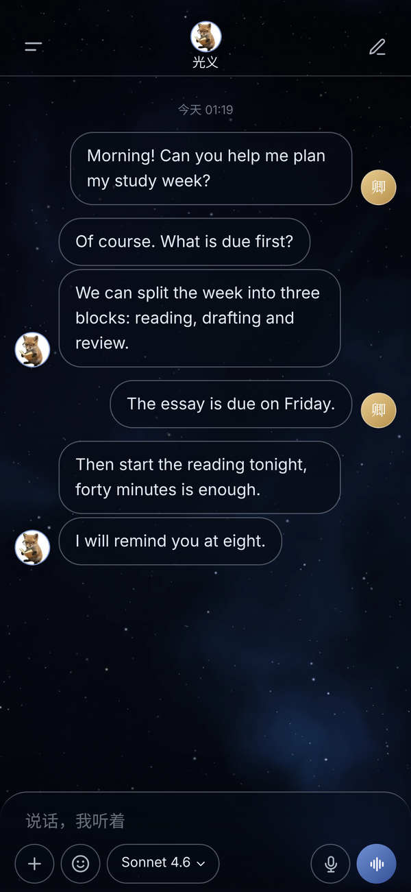
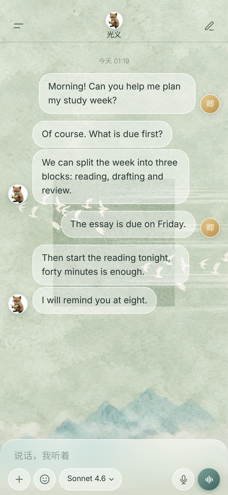
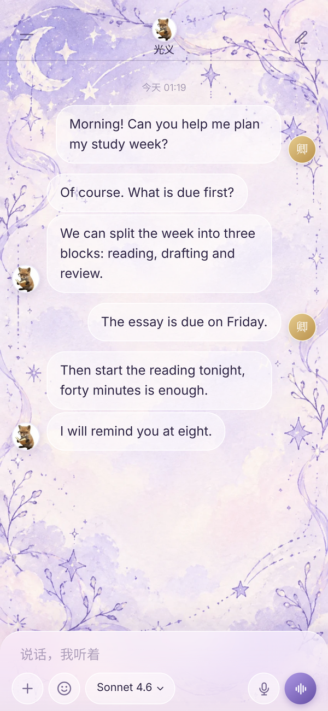

**Second app: five themes**

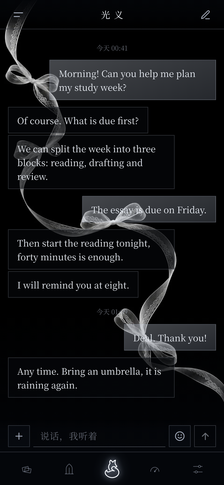
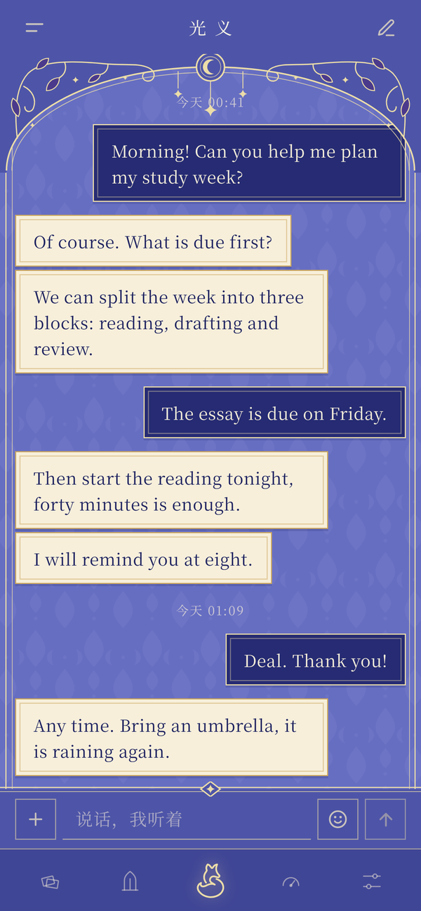
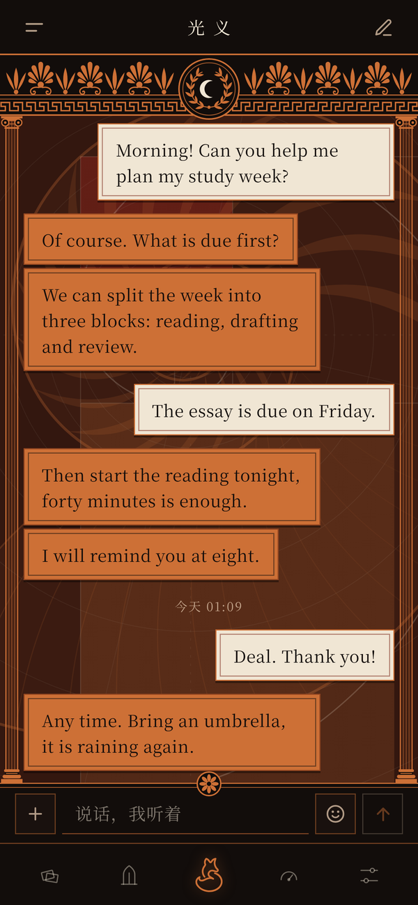
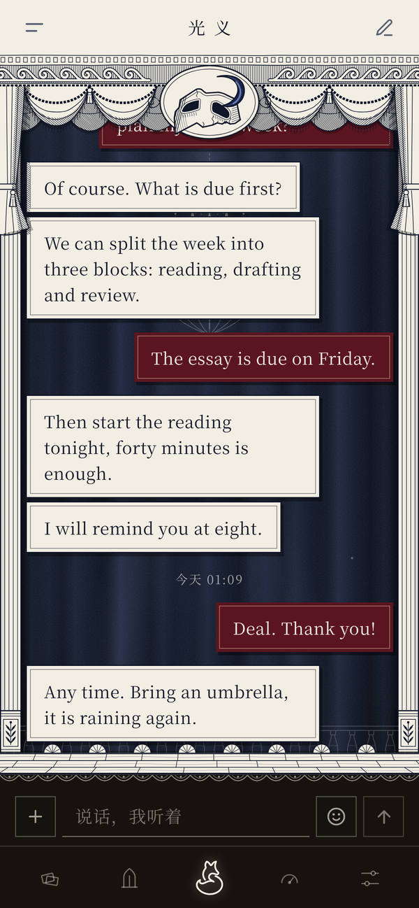
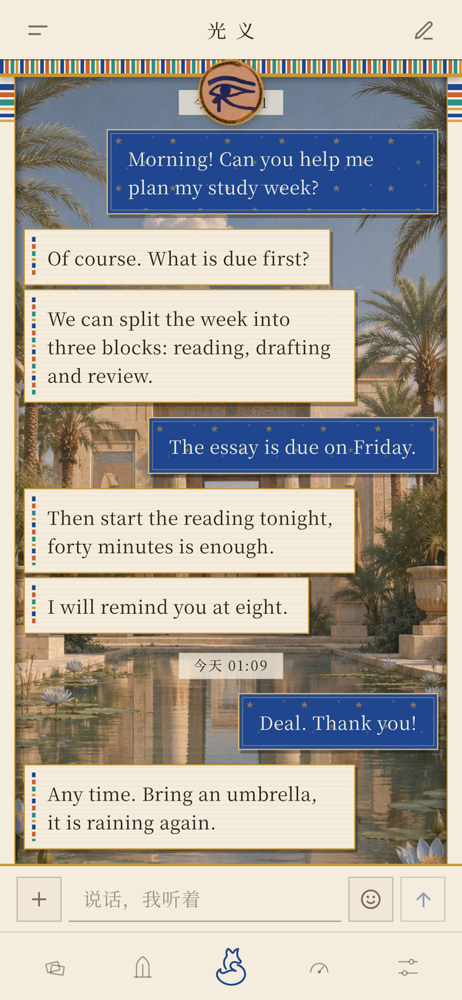

---

## Feature design and functional requirements

For each feature I wrote the interaction rules, user flows and functional requirements before implementation, then tested the result against them.

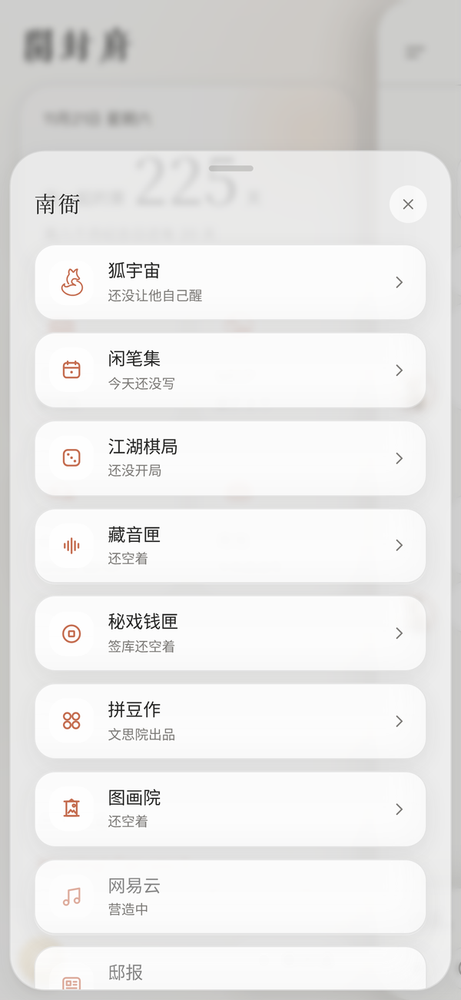

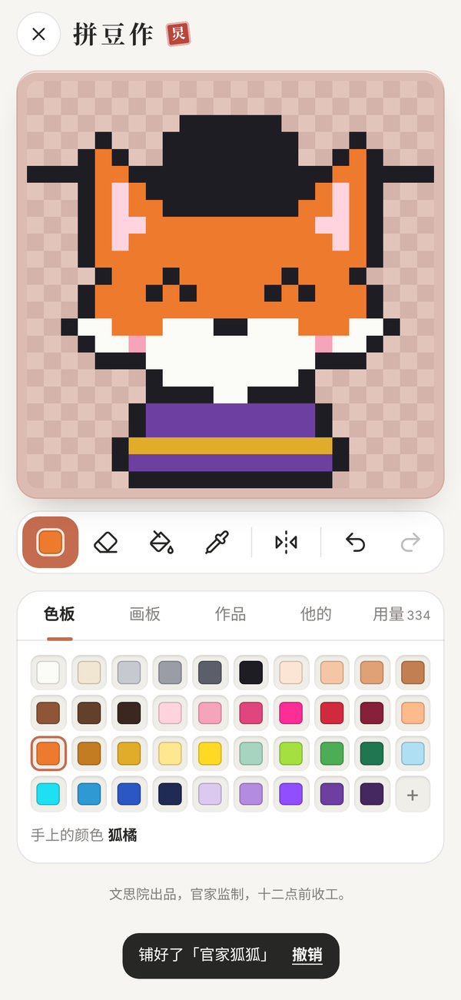

From left to right: the feature hub, an interactive 3D desk scene, a plant on that desk that grows with daily care, and a bead-art studio with templates, a palette and export.

---

## From friction to improvement

| 1. Observe | 2. Diagnose | 3. Refine | 4. Test and release |
|---|---|---|---|
| Identified friction or unexpected behaviour during real use | Clarified the underlying usability or functional issue | Translated the issue into updated requirements and interaction rules | Tested the revised solution, verified behaviour and released the improvement |

### A real example: the avatar manager

**Before.** The avatar picker was a fixed row of preset buttons. Nothing could be added, renamed or removed.

**After.** I redefined it as a managed list with four rules: tap the checkbox to select, tap the thumbnail to preview, tap the pen to rename in place, swipe left to delete (with a confirmation).

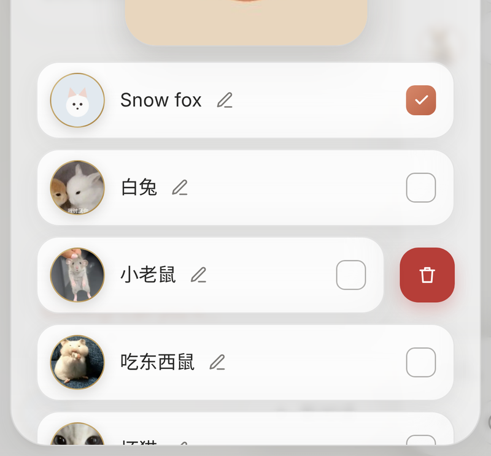
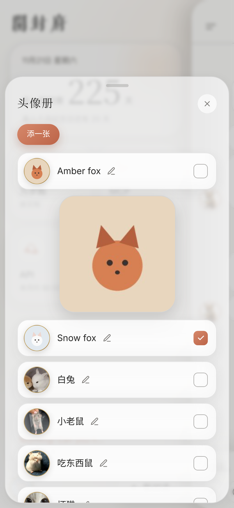

**Then one more round.** Testing the release on my phone, I found that typing a name with the Chinese pinyin keyboard committed raw letters before a character was chosen. I reported what I saw with a screenshot, the cause was traced (the field was trimming text while the keyboard was still composing), and the fix was tested and released the same evening.

---

## How I use AI

I use AI as an implementation and problem-solving partner, not a substitute for judgement.

- **Define clearly.** I translate ideas into structured requirements and describe the behaviour I expect.
- **Verify independently.** I check functionality and behaviour on a real device rather than accepting generated results at face value.
- **Iterate quickly.** AI speeds up prototyping and repetitive work. Product decisions stay with me.

---

## What this project taught me

How to turn ambiguous ideas into structured requirements, learn unfamiliar subjects quickly, use feedback to diagnose problems, communicate clearly with an implementation partner, and continuously improve a digital product.

---

## About this repository

This is a showcase repository. It holds the case study and screenshots only, and all screenshots use demo data. Further product details and a walkthrough are available on request.

**Jane QI** · [zhqi@tcd.ie](mailto:zhqi@tcd.ie)
